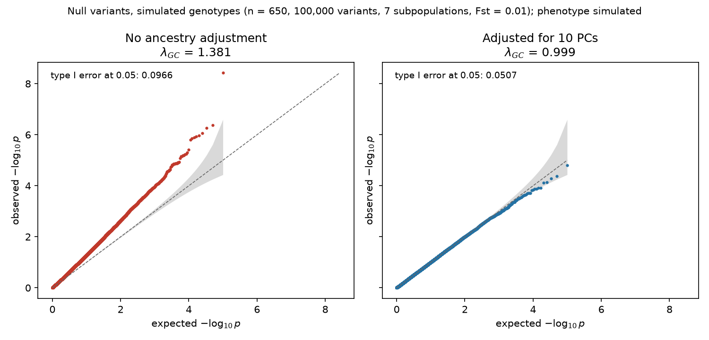

# hbf-gwas

**What this claims, and what it does not.** This is a small, tested GWAS QC
and association pipeline. Its only claim is: *on real 1000 Genomes AFR
genotypes, with an HbF-like phenotype simulated at the three established HbF
modifier loci (BCL11A 2p16, HBS1L-MYB 6q23, HBB cluster 11p15), the pipeline
recovers planted effects at the power predicted in advance, with calibrated
type I error after ancestry adjustment.* **The phenotype is always
simulated.** 1000 Genomes has no HbF (fetal haemoglobin) phenotype, so
nothing here is a biological finding or says anything new about HbF; the
literature effect sizes are only used to decide how large the planted
effects should be.

## Status

The two columns are kept separate on purpose. "Simulated genotypes" means
Balding-Nichols genotypes generated by `hbfgwas.simulate` (for the scripts,
the small synthetic fileset in `tests/synthetic_1kg.py`). The real-data
column changes only when the pipeline has actually been run on 1000 Genomes.

| Component | Run on simulated genotypes | Run on real 1000 Genomes genotypes |
|---|---|---|
| Stratification experiment: lambda_GC and type I error, unadjusted vs 10 PCs | yes, gate passed: lambda_GC 1.381 → 0.9995, type I error 0.0966 → 0.0507 ([run](runs/2026-11-10-sim-stratification/README.md)) | not yet run |
| Locus recovery vs pre-computed power | yes: BCL11A (power 0.997, required) recovered at p = 5.7e-21; HBB cluster (0.531) and HBS1L-MYB (0.218) underpowered, not required, not recovered | not yet run |
| `00_download_1kg.sh` download + manifest | synthetic fileset, in CI | not yet run |
| `01_subset_afr.sh` AFR subset, related samples, biallelic SNPs, duplicates | synthetic fileset, in CI | not yet run |
| `02_qc.sh` per-filter QC table, sentinel report | synthetic fileset, in CI | not yet run |
| `03_pca.sh` long-range LD exclusion, pruning, KING, exact PCA, het | synthetic fileset, in CI | not yet run |
| `04_assoc.sh` simulated phenotype on the genotypes, plink2 `--glm` ± PCs | synthetic fileset, in CI | not yet run |
| `05_report.py` report and Python-vs-plink2 concordance | synthetic fileset, in CI | not yet run |
| Locus table values (`src/hbfgwas/loci.py`) | all `verified: false`; awaiting user sign-off (#3) | n/a |



*Simulated genotypes (n = 650, 100,000 null variants, 7 subpopulations,
Fst 0.01) and simulated phenotype. Summary numbers:
[docs/figures/sim_stratification_summary.json](docs/figures/sim_stratification_summary.json).*

**One thing that did not agree.** Over 1000 phenotype redraws, empirical power
matched the prediction for BCL11A (0.998 vs 0.997) but not for HBS1L-MYB
(0.375 vs 0.218) or HBB cluster (0.419 vs 0.531). This is a secondary,
non-gating outcome. The redraws hold one genotype realization fixed, so they
measure power conditional on it, whereas the formula averages over genotype
draws. A post hoc diagnostic accounts for most of the gap (details in the
[run notes](runs/2026-11-10-sim-stratification/README.md)). Nothing was
changed after the run; how to redesign this outcome is an open decision (#10).

## How it works

1. **Pre-registration first.** `config/analysis.yaml` fixes QC thresholds, 10
   PCs, alpha = 5e-8, seeds, planted effects, and the acceptance criteria
   before any experiment runs. `tests/test_config.py` pins every value the
   brief specifies. Real-data criteria are added later and tagged `prereg-v1`
   before any real association is run; `scripts/04_assoc.sh` checks the tag.
2. **Analytic power** (`hbfgwas.power`): 1-df noncentral chi-square with
   ncp = n R2 / (1 - R2). A locus is *required* to be recovered only if its
   predicted power is >= 0.8; otherwise it is reported as "underpowered, not
   required" with its power.
3. **Simulation** (`hbfgwas.simulate`): Balding-Nichols genotypes with
   configurable Fst; a phenotype with three separate components (planted
   effects, a non-genetic shift by subpopulation, noise). It accepts real
   genotype matrices too.
4. **Reference association** (`hbfgwas.assoc`): vectorised linear regression
   with covariates, exact PCA, lambda_GC, type I error, power, QQ plots, and a
   tolerance check against plink2 `--glm` output. plink2 does the genome-wide
   scan; this module is the tested reference it is compared with.
5. **Gate** (`python -m hbfgwas.gate`): PASS / FAIL / NOT REQUIRED for each
   criterion. CI re-runs the simulated experiment and the gate on every PR,
   so a statistical regression breaks the build.

**1000 Genomes phase 3 is fully called** (no missing genotype calls), so the
missingness filters `--geno 0.02` and `--mind 0.02` cannot remove anything;
`scripts/02_qc.sh` says so explicitly when it runs.

## Reproduce

```bash
/opt/homebrew/bin/python3.12 -m venv .venv          # any Python >= 3.11
.venv/bin/pip install -e ".[dev]"
.venv/bin/python -m pytest                           # unit tests; plink2 end-to-end tests skip without plink2
.venv/bin/python scripts/run_stratification.py --out-dir /tmp/sim --figures-dir ""
.venv/bin/python -m hbfgwas.gate --results /tmp/sim/results.json
```

The stratification run takes a few seconds and reproduces
`docs/figures/sim_stratification_summary.json` (CI checks this).
`pytest -m realdata` is expected to **fail** until the locus table is signed
off. To exercise the shell scripts locally, put `plink2` and `zstd` on PATH
and run `pytest tests/test_scripts.py`.

Real data: see [docs/running-real-data.md](docs/running-real-data.md).

## Out of scope

No mixed models (REGENIE, SAIGE), no imputation, no fine-mapping, no GRCh38,
no ancestries other than 1000 Genomes AFR.

## Layout

| Path | What |
|---|---|
| `src/hbfgwas/` | `loci`, `power`, `simulate`, `assoc`, `gate`, `experiment`, `pipeline`, `config` |
| `config/analysis.yaml` | pre-registration |
| `scripts/` | `00`-`05` real-data pipeline, `run_stratification.py`, `check_language.py` |
| `resources/` | long-range LD regions (GRCh37), with source and verification status |
| `runs/<date>/` | committed documentation of each run |
| `docs/` | brief, decisions, walkthrough, figures |
| `tests/` | unit tests, synthetic plink2 fileset, end-to-end script tests |

Open decisions for the user: sign-off of the locus table (#3) and the
secondary power outcome (#10). Decisions and who made them:
[docs/decisions.md](docs/decisions.md).
Changes: [CHANGELOG.md](CHANGELOG.md). The brief: [docs/BRIEF.md](docs/BRIEF.md).
